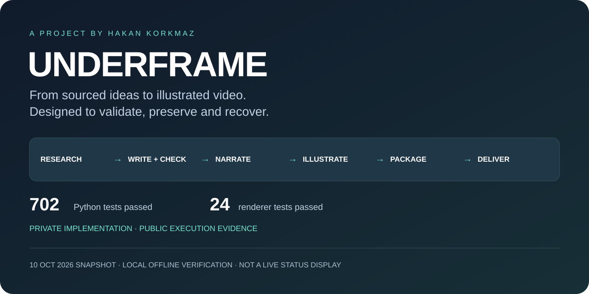
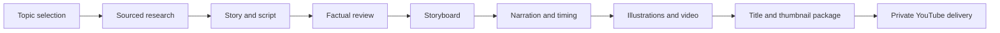

# UNDERFRAME

### AI-assisted video production, with checkpoints and recovery built in.

**A project by [Hakan Korkmaz](https://github.com/hakankz).** This repository presents a working private software project through a system overview and sanitized execution evidence. The production source and proprietary prompts are retained privately.

UNDERFRAME coordinates the work behind illustrated educational videos: finding a topic, researching it, developing and checking a script, planning scenes, producing narration, rendering visuals, preparing release materials, and delivering a video privately to YouTube.

The engineering challenge is continuity. A video takes many dependent steps, and external services can fail or return incomplete results. The system records what happened, checks completed work before reusing it, and stops when continuing would risk an uncertain paid request or invalid output.

**Verification snapshot · 10 October 2026:** 702 Python tests passed; 24 renderer tests passed. These are local tests of the private implementation, with mocked providers and temporary fixtures. They are not public GitHub Actions results.

[Execution evidence](evidence/README.md) · [Engineering case study](CASE-STUDY.md) · [Current capabilities](#current-capabilities)

## From an idea to a private delivery

Each step has a saved completion checkpoint. An output file alone does not count as success: the controller checks the relevant evidence and validation state before advancing.

## What makes this an engineering project

| Capability | Purpose |
| --- | --- |
| Resumable orchestration | Continue from validated completed work instead of rebuilding an episode from the beginning. |
| Asynchronous job tracking | Preserve provider job identity so a pending request can be retrieved. |
| Paid-request safeguards | Block blind resubmission when the previous outcome is uncertain. |
| Frozen production builds | Keep an episode tied to its recorded code, configuration and runtime. |
| Independent evidence review | Check narration before it reaches production stages. |
| Measured audio timing | Fit scene timing to the recorded narration. |
| Artwork and media validation | Check illustration contracts and output integrity before release. |
| Progress and incident records | Make failures and recovery decisions inspectable. |

## Evidence from the working system

The [evidence directory](evidence/README.md) contains selected facts from actual local runs, rather than example success messages:

- Exact summary excerpts from the Python and renderer test runs.
- A sanitized checkpoint snapshot for Episode 011: research, writing, factual review, storyboard and narration complete; visual production stopped on a pacing validation failure.
- An audio quality summary: **268.622 seconds**, **707 words**, **13 narration segments**, with local audio checks passed.
- A checksum manifest for the published evidence files.

The failed visual checkpoint is included deliberately: it demonstrates that the controller enforces a quality constraint rather than reporting completion because files exist. See the [case study](CASE-STUDY.md).

## Current capabilities

| Area | Status at the snapshot |
| --- | --- |
| Topic discovery, research, script, factual review and storyboard | Implemented; Episode 011 checkpoints complete. |
| Narration generation and measured timing | Implemented; Episode 011 checkpoint complete. |
| Illustrated rendering | Implemented; Episode 011 currently blocked by a scene pacing plan. |
| Release title, thumbnail, description and chapters | Implemented; pending for Episode 011. |
| Private YouTube delivery | Implemented; not rerun or independently reverified in this snapshot. |
| Public publishing and scheduling | Not connected. |
| Burned-in captions | Withdrawn; skipped in current clean-video builds. |

## Technology

Python · JavaScript/TypeScript · React · Remotion · FFmpeg · AI research and generation APIs · YouTube Data API

## Project ownership and development

Hakan directs the product requirements, editorial and visual policies, and acceptance decisions for this personal project. Development uses AI assistance, with local verification and documented recovery work. The integration and operational evidence shown here belong to the project; generated content and provider services are not presented as independently developed foundation models.

## Public showcase boundary

This is a portfolio repository, not a runnable distribution. It contains freshly written documentation, an original overview graphic and selected sanitized evidence. It does not include the production source, prompts, selection/scoring internals, credentials, provider request payloads, account identifiers, private receipts, full episode files or frozen builds.

The published test summaries provide evidence of a local run; readers cannot independently rerun the private suite from this repository. A checksum helps detect changes to the published files; it does not constitute third-party attestation.

## Contact

For a project discussion or a controlled walkthrough, contact [Hakan Korkmaz on GitHub](https://github.com/hakankz).

No open-source license is granted for the private implementation. See [NOTICE.md](NOTICE.md) for the showcase's publication boundary.
